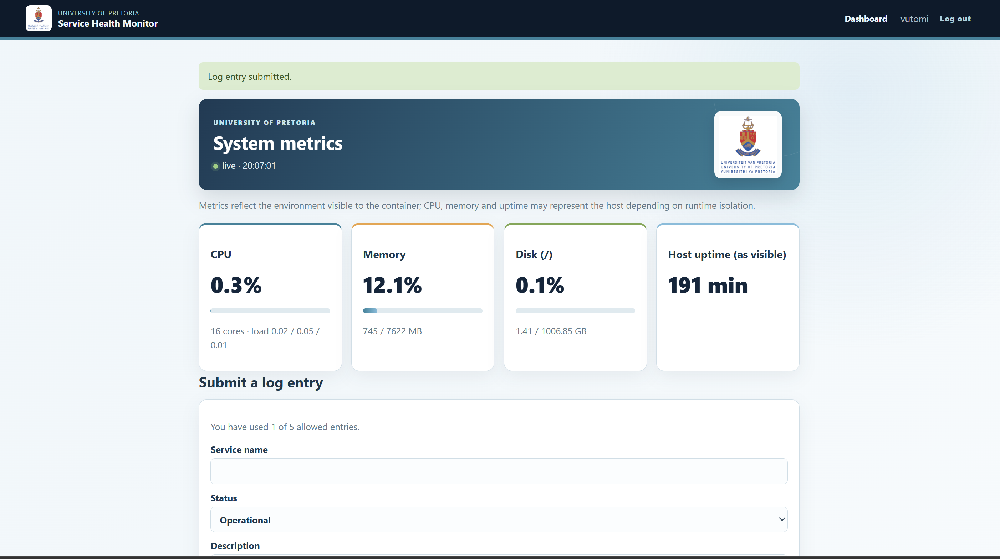

# Service Health Monitor — TechTeam Technical Assessment 2026



A secure Flask with SQLite application in **one custom Alpine Linux Docker container**.


#### **DEMO PRESENTATION VIDEO**: 

## What the application does

- Standard users **register** and **log in** using salted PBKDF2 password hashes, then see a dashboard.
- Dashboard shows periodically refreshed CPU, memory, disk, load, and uptime values sourced through `psutil`.
- Dashboard stores CPU, memory, and disk samples about once per minute while viewed and charts the last 24 hours; older samples are pruned.
- Authenticated users submit support tickets with a generated `INC-0001` reference, service status, priority, and description.
- Tickets track lifecycle (`Open`, `In Progress`, `Resolved`, `Closed`), assignment, responses, resolution time, and a change timeline.
- Administrators can grant the Support role, assign tickets, filter and export incidents as CSV, and lock/unlock user accounts. Support staff can work on tickets assigned to them; requesters see their own tickets and in-app notifications.
- The ticket form suggests open incidents for the same normalized service. Suggestions never prevent submission or automatically merge tickets.
- Each account can submit **at most five tickets in total** by default; even if an administrator deletes a ticket, the quota is **not restored**. This is a deliberate anti-spam decision. The counter is persistent and concurrency-safe.
- Operational service names, descriptions, and administrator responses are **encrypted at rest**. User passwords are **hashed**, not encrypted.
- Login attempts are rate-limited persistently: eight failures in five minutes block the source IP and attempted account across IPs for five minutes. A successful login clears that account's and source IP's failure buckets. Failed attempts are recorded without passwords; authentication events are retained for 90 days.
- Administrators can review recent failed logins, active blocks, locked accounts, and an audit trail of administrative changes in the Security console.
- Users can change their passwords after verifying the current password. Changing a password invalidates other sessions; authenticated sessions also expire after 15 minutes without activity.

## Enhancements beyond the basic functional requirements

The following areas add operational value beyond the basic registration, login, ticket submission and administrator moderation requirements:

### System monitoring and dashboard

- Collects CPU, memory, disk, load and system-uptime information from `psutil` and refreshes it on the dashboard.
- Records CPU, memory and disk samples approximately once per minute while the dashboard is open.
- Presents the last 24 hours as resource-history charts and automatically prunes older samples.
- Labels the application clearly as a **Service Health Monitor**, with a responsive dashboard theme and service-focused status presentation.
- Uses the SQLite-backed `/api/metrics/history` endpoint for historical readings while keeping data access authenticated.

### Incident and support workflows

- Converts event submissions into incident tickets with automatic `INC-0001`, `INC-0002`, and subsequent references.
- Supports open, in-progress, resolved and closed ticket lifecycle states.
- Provides low, medium, high and critical priority levels.
- Adds administrator assignment, Support roles, assigned-ticket access and requester-only visibility.
- Records administrator responses, in-app notifications and a chronological timeline of changes.
- Tracks resolution time and reopened/resolved timestamps.
- Supports requester, date, service, priority and status filtering, plus formula-safe CSV export.
- Suggests open incidents for the same normalized service without blocking submission or merging reports automatically.
- Migrates existing log records into the ticket model while preserving their content, status and creation timestamp.

### Security hardening

- Stores persistent login-rate buckets in SQLite, protecting against application restarts.
- Applies separate IP and account throttling, with eight failures in five minutes triggering a five-minute block.
- Records failed logins and rate-limit events without storing passwords or submitted password values.
- Retains authentication events for 90 days and exposes recent activity through an administrator Security console.
- Shows active login blocks and locked accounts in the Security console.
- Records administrative actions transactionally with actor, target, details, IP address and timestamp.
- Allows users to change passwords after verifying the current password and invalidates other sessions by incrementing the account session version.
- Logs locked accounts out of existing sessions on their next request and prevents locked accounts from logging in again.
- Enforces a 15-minute inactivity timeout on authenticated sessions.
- Adds CSP, no-sniff, anti-framing, same-origin referrer and no-store HTTP headers.
- Encrypts ticket service names, descriptions and administrator response text with Fernet.
- Uses role-based route decorators, parameterized SQL, Jinja escaping, CSRF protection and atomic submission quotas.

### Testing and operational resilience

- Tests security and functional behavior against isolated temporary SQLite databases rather than the live `/data/monitor.db`.
- Covers metric-history spacing and pruning, ticket migration and workflows, notifications, CSV export, duplicate suggestions, rate limiting, locked accounts, password changes, session expiry and administrative auditing.
- Runs in an unprivileged Alpine Linux container and preserves accounts, tickets, metrics, encryption keys and security records in a named Docker volume.
- Includes health and application startup checks for local Docker deployment.

## 2. Directory structure

```text
service-health-monitor/
├── app.py                 Flask routes, auth, metrics, database and encryption
├── Dockerfile             Alpine image; apk installs Python/SQLite/dependencies
├── templates/             Jinja pages for dashboards, tickets, admin, and notifications
├── static/                CSS and auto-refresh JavaScript
├── tests/test_app.py      Functional and security tests
├── .dockerignore
├── .gitignore
├── README.md
└── CV.pdf             
```

## Before you start

Install Docker Desktop (Windows/macOS) or Docker Engine (Linux). For Windows, use PowerShell or a WSL terminal; the commands below use a POSIX shell (Linux/macOS/WSL).

From the directory containing `Dockerfile`, build:

```bash
docker build -t techteam-health-monitor .
```

**Recommended first launch (persistent volume):**

```bash
docker run -d --name techteam-health-monitor \
  -p 5000:5000 \
  -v techteam-monitor-data:/data \
  -e ADMIN_USERNAME=admin \
  -e ADMIN_PASSWORD='REPLACE-WITH-A-UNIQUE-LONG-PASSWORD' \
  -e SECRET_KEY="$(openssl rand -hex 32)" \
  techteam-health-monitor
```

Open **http://localhost:5000**. Use the configured administrator credentials to log in, or select **Register** to create a normal user. Do not reuse the sample password text. For repeatable deployment, store generated keys securely and supply the *same keys* at each restart.

**Minimum launch (also supported):**

```bash
docker run --rm --name health-demo -p 5000:5000 techteam-health-monitor
```

On a brand-new data directory, the app generates an administrator password, prints it **once** in container logs, and generates persistent signing/encryption keys. Retrieve the generated password with `docker logs health-demo`. **This convenience path is intended only for a local demo:** container logs can expose that initial password to anyone who can read them; prefer supplying `ADMIN_PASSWORD` for normal use. No password is stored in the database as plaintext.

## Docker commands and troubleshooting

```bash
# Show runtime logs
docker logs techteam-health-monitor

# Check container health and process status
docker ps

# Stop/remove without deleting its named volume
docker stop techteam-health-monitor
docker rm techteam-health-monitor

# Rebuild after changing code
docker build -t techteam-health-monitor .
```

The default image uses **port 5000** and a non-root `app` user. SQLite files and encryption keys are stored under `/data`, with volume persistence. You can map a different host port, for example `-p 8000:5000`, then visit http://localhost:8000.

If you get `port is already allocated`, stop the other service or use `-p 8000:5000`. If the administrator account seems to ignore updated environment variables, that is expected: the account is bootstrapped only when the database contains no administrators. New passwords supplied on later starts do **not** overwrite stored password hashes. A username collision with an existing standard user now fails explicitly instead of silently leaving you with no administrator. To reset a demonstration, use a **new empty named volume**, not the production volume.

### Supported environment variables

| Variable                | Description                                                                                          |
| ----------------------- | ---------------------------------------------------------------------------------------------------- |
| `DATA_DIR`            | SQLite and key storage directory; default `/data`                                                  |
| `SECRET_KEY`          | Flask signing key. If missing, generated and written to `/data/.secret_key` (mode 0600).           |
| `DATA_ENCRYPTION_KEY` | Optional Fernet encryption key. If absent, generated and written to `/data/.data_key` (mode 0600). |
| `ADMIN_USERNAME`      | Initial admin name; default `admin`.                                                               |
| `ADMIN_PASSWORD`      | Initial admin password. If missing, generated and printed**once** to Docker logs.              |
| `MAX_LOGS_PER_USER`   | Total submission allowance, default `5` (allowed: 1–100).                                         |
| `COOKIE_SECURE`       | `1` for HTTPS deployments, `0` for local HTTP.                                                   |

**Encryption-key note:** `DATA_ENCRYPTION_KEY` must be a valid Fernet key, e.g. generated with:

```bash
python3 -c 'from cryptography.fernet import Fernet; print(Fernet.generate_key().decode())'
```

**Back up the SQLite database and `/data/.data_key` together.** Losing the key means encrypted log details cannot be recovered. Changing an externally supplied `DATA_ENCRYPTION_KEY` for an existing database makes existing encrypted data unreadable. A host-side data-volume backup can also contain pre-encryption legacy data, so protect backups and snapshots.

## 5. Architecture and request flow

```text
Browser ──HTTP:5000──> Gunicorn (1 worker, 4 threads)
                          │
                          ▼
                     Flask routes
               ┌──────────┴──────────┐
               │                     │
     Session + role checks      Metrics from psutil
               │
        Flask-WTF CSRF
               │
    Parameterized SQL queries
               │
           SQLite /data
       users          logs
    salted hashes  Fernet-encrypted fields
```

- **Alpine Linux**: the `Dockerfile` starts from `alpine:3.22`, **not** `python:alpine` or `node:alpine`. Packages installed through Alpine's `apk`: `python3`, `py3-flask`, `py3-flask-wtf`, `py3-psutil`, `py3-gunicorn`, `py3-cryptography` and `sqlite`.
- **Flask**: handles authentication, pages, input validation, access-control decorators and API routes; Jinja renders escaped templates.
- **SQLite**: stores account, ticket, response, timeline, notification, and metric-history data with foreign keys and WAL mode; a named Docker volume persists state.
- **Gunicorn**: one worker with four threads is the small-app baseline; login-throttle counters live in SQLite and survive process restarts.
- **Fernet**: encrypts ticket `service`, `description`, and response text before writing to SQLite. Status, priority, references, IDs, timestamps, username and flag state remain unencrypted metadata to support filtering, querying and moderation; don't put passwords or other secrets into those fields.

**Routes:** `/register`, `/login`, `POST /logout`, `GET/POST /account/password`, `/dashboard`, `GET /tickets`, `GET /tickets/<id>`, `POST /tickets`, legacy `POST /logs`, `GET /api/metrics`, `GET /api/metrics/history`, `GET /api/tickets/suggestions`, `/notifications`, `POST /notifications/<id>/read`, `/admin`, `/admin/security`, `/admin/tickets.csv`, `POST /tickets/<id>/status`, `/tickets/<id>/priority`, `/tickets/<id>/assign`, `/tickets/<id>/responses`, `/admin/logs/<id>/flag`, `/admin/logs/<id>/delete`, `/admin/users/<id>/support`, `/admin/users/<id>/lock`, `/healthz`.

## 6. Security decisions and their limits

| Risk                       | Protection                                                                                                       | Important limit                                                                                        |
| -------------------------- | ---------------------------------------------------------------------------------------------------------------- | ------------------------------------------------------------------------------------------------------ |
| Password compromise        | Salted PBKDF2-HMAC-SHA256, 600,000 iterations                                                                    | Password policy is basic: 10–128 characters, no breach-password check                                 |
| SQL injection              | SQLite `?` parameters for user data                                                                            | SQL query structure is authored in code; status filter validated against allowlist                     |
| Stored/reflected XSS       | Jinja escaping, restricted CSP, input length checks                                                              | Do not add `                                                                                           |
| Cross-site request forgery | Flask-WTF token on every mutating POST                                                                           | CSRF checks depend on a stable Flask `SECRET_KEY`                                                    |
| Unauthorized admin access  | Backend `@admin_required`; never trust a hidden link                                                           | Standard users receive HTTP 403 on admin routes                                                        |
| Ticket access              | Requesters see their own; support sees assigned tickets; admins see all                                          | Support staff cannot browse unassigned reports                                                         |
| Submission spam            | Atomic `BEGIN IMMEDIATE` / count update / insertion                                                            | Quota counts**lifetime entries**, not entries remaining after deletion                           |
| Account lock               | Locked users cannot log in; active sessions are revoked on the next request                                      | Unlock through the administrator user controls                                                         |
| Session theft              | `HttpOnly`, `SameSite=Lax`, 2h lifetime; `Secure` opt-in                                                   | Deploy with TLS for real users                                                                         |
| Stale sessions             | 15-minute inactivity timeout; password change increments a per-user session version                              | Sessions are signed client-side; timeout is enforced on the next request                               |
| Login guessing             | SQLite-backed IP and account-across-IP buckets; eight failed attempts in five minutes create a five-minute block | Shared IPs may also be throttled; use a reverse proxy only when trusted proxy configuration is correct |
| Login auditing             | Failed usernames, source IPs, timestamps, and rate-limit events; passwords are never recorded                    | Events older than 90 days are pruned on the next security event or console visit                       |
| Administrator actions      | Admin ID, action, target, details, IP, and timestamp recorded transactionally                                    | Audit trail is stored in the same application database and needs protected backups                     |
| Ticket confidentiality     | Encrypted service, description, and response text with Fernet                                                    | Other ticket metadata remain plaintext; protect DB backups and encryption keys                         |
| HTTP response hardening    | CSP, no-sniff, anti-framing, no-store                                                                            | This does not replace HTTPS                                                                            |
| Container privilege        | Runs as dedicated non-root Linux user                                                                            | Docker daemon/host security remains operator responsibility                                            |

**Metrics accuracy:** `psutil` uses the system interfaces visible from inside Docker. Values such as CPU count, memory totals and uptime **may reflect the Docker host rather than strict container-cgroup consumption**. Treat them as indicative system metrics; for exact cgroup usage, implement `/sys/fs/cgroup` support as an enhancement.

**Legacy database migration:** On startup, existing log rows are preserved as open, medium-priority tickets with `INC-` references and an initial timeline event. Existing service statuses remain unchanged. Unencrypted `service` and `description` values are encrypted in the same migration. **Make an offline backup first**, and preserve the encryption key. Older backups and database journal artifacts may still contain historical plaintext and need separate protection.

**First-run keys:** The fallback file keys are stored with restrictive permissions inside the `/data` volume, which is fine for a self-contained assessment demo but is weaker than a managed secret store. Keep this limitation explicit in an interview.

## Automated tests

Tests use `unittest` and Flask's test client. To run them in the image use:

```bash
docker run --rm --entrypoint python3 techteam-health-monitor \
  -m unittest discover -s tests -v
```

These test routes, ticket migration, role-based access, ticket lifecycle, assignment, encrypted responses, notifications, timeline, search, CSV export, duplicate suggestions, submission quota, XSS escaping, CSRF protection, persistent login throttling, password changes and session invalidation, inactivity expiry, security-console access, and administrator auditing. Tests use a temporary database instead of changing `/data/monitor.db`.

**Important:** The tests intentionally disable CSRF only for ordinary route tests that do not provide HTML CSRF tokens; one separate test turns CSRF **back on** and verifies an invalid request returns 400. This is test-only configuration and does not disable protection in the running app.

### Manual acceptance checks

1. `docker build -t techteam-health-monitor .` succeeds from the repository root.
2. `docker run` brings up the app on port 5000; `docker ps` reports the container up and eventually healthy.
3. Register `student1`; confirm the password is not visible in plaintext in SQLite.
4. Log in as `student1`; verify CPU/memory/disk figures update every 5 seconds and the history chart begins plotting after two samples.
5. Submit five valid tickets; confirm the sixth fails, even after a page refresh.
6. Submit description `<script>alert(1)</script>`; confirm it displays as text, not executed code.
7. Visit `/admin` as `student1`; confirm a 403 response.
8. Promote a user to Support, assign a ticket, and confirm the support user can access only their assigned tickets.
9. Change ticket status/priority and add a response; verify the requester receives notifications and can view the timeline.
10. Filter tickets by requester, date, service, priority and status; export the filtered CSV.
11. Submit another ticket for the same service; confirm matching open-ticket suggestions appear without blocking submission.
12. Stop and recreate the container using the same named volume; confirm users, tickets, quotas, notifications and encrypted content persist.
13. Check with SQLite that ticket service/description and response bodies begin `enc:v1:` and do not expose submitted text.
14. Run the automated tests and keep screenshots of the successful application and terminal output.

## 8. How this submission satisfies the assessment

| Requirement in assessment                     | Implementation / evidence                                        |
| --------------------------------------------- | ---------------------------------------------------------------- |
| One container using base Alpine               | `Dockerfile` (`FROM alpine:3.22`)                            |
| Install Flask, SQLite inside                  | Docker `apk add` instructions                                  |
| Registration, login, password hashing         | `register`, `login`, Werkzeug PBKDF2                         |
| Standard / administrator access               | `is_admin` database field and `@admin_required`              |
| Live health data                              | `collect_metrics()`, `/api/metrics`, `static/dashboard.js` |
| Service, status, description                  | Dashboard form and `submit_log()`                              |
| Five logs per user                            | Atomic `submission_count` check in transaction                 |
| All logs unified for administrators           | `/admin` join of users and logs                                |
| Flag/delete and lock user                     | Three POST `/admin/...` routes                                 |
| SQL injection, XSS and CSRF defense           | Parameters, Jinja+CSP, Flask-WTF                                 |
| No plaintext passwords/sensitive descriptions | PBKDF2 and Fernet encryption                                     |
| Environment-based secrets                     | `SECRET_KEY`, `DATA_ENCRYPTION_KEY`, admin credentials       |
| Private repository, CV, reviewer invitation   | **User must complete manually**; see section 9             |
| Clear instructions, security justification    | This README                                                      |
| App working on 5000 or 8000                   | Docker `EXPOSE 5000` and mapped host port                      |

## Potential optional improvements

1. **Authenticator-based TOTP** for optional or mandatory two-factor login.
2. **Exact container-cgroup metrics** instead of host-level/system-interface values for CPU and memory.
3. **Service reachability, response-time and availability-history monitoring** with downtime and uptime-percentage calculations.
4. **Threshold alerts and automatic incident generation** for CPU, memory, disk or service-failure conditions.
5. **Encryption-key rotation** that preserves access to existing encrypted ticket data.
6. **Dependency vulnerability scanning** and a repeatable documented database backup/restore process
